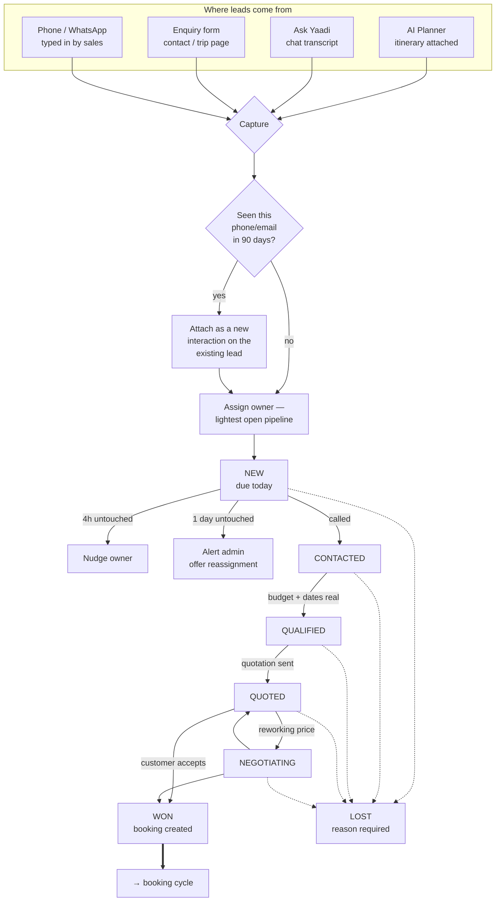
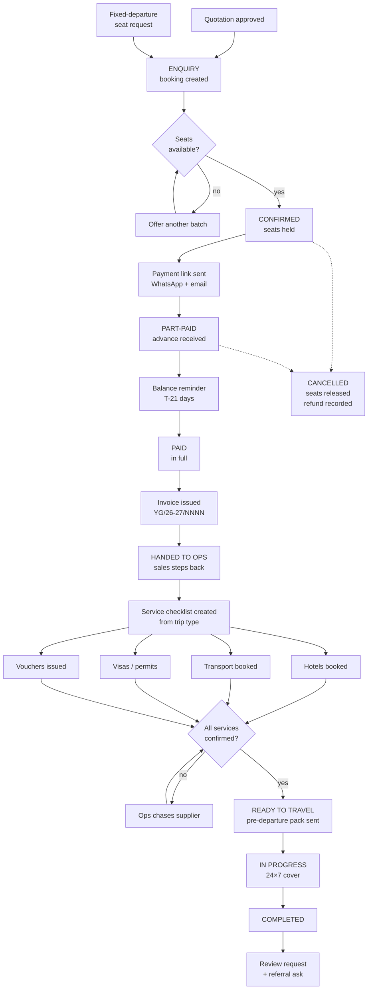
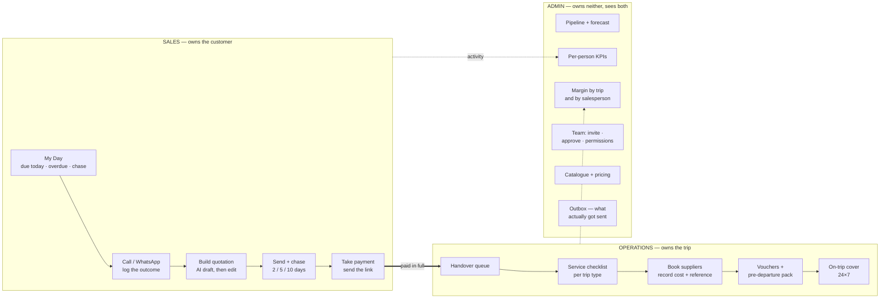

# Workflows — who does what, and when

**Date:** 2026-10-01 · **Audience:** admin, sales, operations
**Source of truth for:** stages, permissions, handoffs, notifications

> **Superseded in part, 2026-10-09.** Role duties, permissions and feature
> status now live in [`team-operating-model.md`](./team-operating-model.md),
> which was written against a fresh audit of the running system. The diagrams
> below are still accurate; the status columns here are not.

Three roles, three jobs. The rule the whole system is built around:

> **Sales owns the customer until the money is in. Operations owns the trip from
> the money until they come home. Admin owns neither and sees both.**

Everything below follows from that sentence.

---

## 1 · The lead cycle

**Rules the system enforces, not conventions people remember:**

- A new lead is due **today**. An enquiry that sits overnight goes to a
  competitor.
- `LOST` **cannot be set without a reason** — picked from a list, because free
  text produces unusable reporting.
- Every lead has an owner. No orphans, ever.
- A salesperson sees only their own pipeline plus unassigned. Scope is enforced
  in the API, not the UI, so editing the query string changes nothing.

## 2 · The booking cycle

**Rules the database enforces:**

- Seats cannot go negative, and cannot exceed the batch total. Both are CHECK
  constraints, not application logic.
- Seats are held by `confirmed`, `part-paid`, `in-progress` — **releasing a seat
  on a part-paid booking would sell it twice.**
- An invoice number is unique per financial year and immutable. Issuing twice
  returns the same number.
- A payment that would exceed the booking total is refused unless overridden
  deliberately.
- A booking must have an origin — a quotation or a departure. No floating
  bookings.

## 3 · Who does what

**The handoff is the hinge.** It happens on **paid in full**, not on booking,
and it is explicit — a salesperson hands over and stops owning it. Before that
moment, operations should not be spending money on a trip that is not paid for.
After it, sales should not be fielding "what time is my pickup" calls.

## 4 · Notifications — who hears what, and where

In-app always works; it is a record in this system and needs no provider.
Email and WhatsApp need a provider configured.

| Event | Customer | Sales | Ops | Admin |
|---|---|---|---|---|
| Enquiry received | ack (email + WA) | **in-app + WA** | — | in-app |
| Lead untouched 4h | — | **nudge** | — | — |
| Lead untouched 1 day | — | nudge | — | **alert** |
| Quotation sent | **link (WA + email)** | — | — | — |
| Quotation viewed | — | **in-app** | — | — |
| No reply 2 / 5 days | reminder | in-app | — | — |
| No reply 10 days | — | **"decide"** | — | in-app |
| Quotation accepted | receipt | **in-app + WA** | — | in-app |
| Payment link sent | **link** | — | — | — |
| Payment received | receipt | **in-app** | — | in-app |
| Paid in full | receipt + invoice | in-app | **in-app — new handover** | in-app |
| Service confirmed | — | — | in-app | — |
| Service overdue | — | — | **alert** | alert |
| Ready to travel | **pre-departure pack** | in-app | in-app | — |
| T-7 days | reminder | — | in-app | — |
| Trip completed | **review request** | in-app | — | in-app |
| Payment failed | **retry link** | **alert** | — | alert |
| Seats low on a held batch | — | in-app | — | in-app |

**The principle:** the customer hears about *their trip*. Sales hears about
*their leads*. Ops hears about *work to do*. Admin hears about *exceptions* —
never the routine, or the alerts stop being read.

---

## 5 · Permissions

| Capability | Sales | Ops | Admin |
|---|---|---|---|
| See own leads | yes | — | yes |
| See everyone's leads | — | — | yes |
| Edit lead stage | own | — | any |
| Transfer a lead | own | — | any |
| Build / send a quotation | own | — | any |
| Approve a quotation | own | — | any |
| Record a payment | own | — | any |
| Issue an invoice | — | — | yes |
| Hand to operations | own | — | any |
| See the handover queue | — | yes | yes |
| Add / update services | — | yes | yes |
| See supplier cost | — | yes | yes |
| See margin | own deals | — | everything |
| Catalogue + pricing | — | — | yes |
| Invite / approve staff | — | — | yes |
| Reports across the team | — | — | yes |
| Outbox | — | — | yes |

Two deliberate choices:

**Ops never sees margin on the sales side, and sales never sees supplier
invoices.** Each sees the cost of their own half. It keeps negotiation clean.

**Only admin issues invoices.** An invoice is a legal document with a sequential
number; it is not a sales action.
